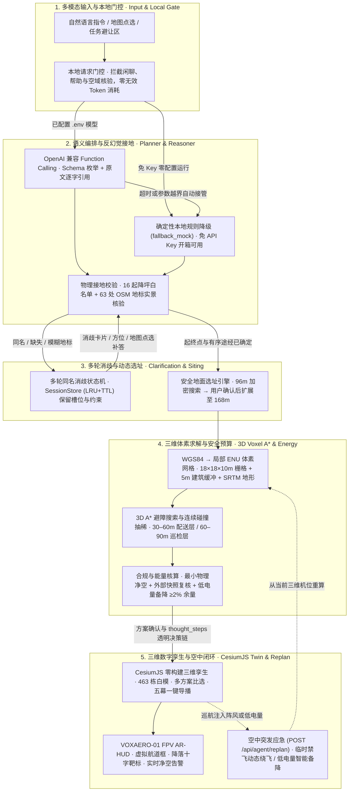

<p align="center">
  
</p>

<h1 align="center">VoxAero · 维空智航</h1>

<p align="center">面向真实城市场景的体素化低空三维导航与空间智能体数字孪生调度平台<br>首个实景示范场景：武汉大学信息学部（463 栋 OSM 真实白模 + SRTM 地形）</p>

<p align="center">
  <strong>中文</strong> · <a href="README_EN.md">English</a>
</p>

<p align="center">
  
  
  
  <a href="docs/TEST_PLAN.md"></a>
  <a href="docs/TEST_PLAN.md#最近验证"></a>
  <a href="LICENSE"></a>
</p>

<p align="center">
  <a href="#系统架构与防幻觉设计">🏗️ 系统架构</a> ·
  <a href="#快速体验">🎮 快速体验</a> ·
  <a href="#快速开始免-api-key-开箱即用">🚀 快速开始</a> ·
  <a href="#配置大模型可选">🔧 配置模型</a> ·
  <a href="#核心指标与验证">📊 核心指标</a> ·
  <a href="#场景与数据契约">🗺️ 数据契约</a>
</p>

输入「从珞瑜门到青年宿舍楼」，调度台会识别同名入口并弹出消歧卡片，继而在真实地形与建筑包络约束下动态搜寻可安全起降、可接入航层的地面点。确认方案后，可点击 **「一键导播」** 或手动起飞，切换至 **VOXAERO-01 第一人称 AR-HUD** 观察虚拟三维航道框，并在巡航途中触发 **临时禁飞区动态绕飞** 与 **低电量（≥2% 落地余量）智能备降**。


<details>
<summary>🎬 观看 8 秒仿真动图 · 从同名消歧、候选预览到第一人称飞行</summary>


</details>

---

## 系统架构与防幻觉设计

低空物理空间对安全零容忍：**大语言模型擅长理解复杂自然语言意图，但不能直接生成坐标、高度或宣称某条航线“安全”。** VoxAero 采用 **「语义编排与物理求解严格解耦」** 的架构——模型只负责受约束的结构化意图提取，所有地名核对、地面选址、三维避障与电量预算均由确定性空间引擎闭环验证。



### 四重物理安全防线（约束 LLM 幻觉）

1. **Schema 枚举 + 原文逐字引用接地**：`parse_dispatch_intent` 将起降坪和禁飞区限定为当前场景的白名单枚举；`extract_spatial_task` 要求模型逐字引用原句中的地标短语，后端核查其存在于用户输入且不复用其他槽位，杜绝编造地名或坐标。
2. **多轮状态机消歧而非盲猜**：遇到同名入口（如东/西两处「珞喻门」）、缺失起终点或未收录地标时，通过带 TTL 的 `SessionStore`（`clarification_token` 10 分钟有效）渲染交互式消歧卡片或开放地图点选，多轮补答保留已确认槽位、硬限高与避让区。
3. **96m / 168m 确定性地面选址与 ENU 3D A***：对非固定起降坪地标，先在 **96 米**内采样并自动剔除道路、水面、地形起伏超限（>1.5 m）、建筑净空不足或围栏内点位，验证垂直接入航层后才进入规划；近场无解时必须经用户显式确认才扩展至 **168 米**。所有巡航段在 **18×18×10 m 局部 ENU 体素**中做 3D A* 搜索，并经连续线段碰撞检测抽稀与拐角倒角平滑。
4. **空中动态重规划与 ≥2% 电量硬余量**：突发阵风/临时禁飞区从无人机当前实时三维机位重算绕飞并保留剩余途经点；低电量备降结合航时与累计爬升估算耗电，**强制要求落地余量 ≥ 2%**，不可达时诚实返回 `HTTP 409` 并悬停留痕，绝不输出冒险航线。

---

## 快速体验

> **30 秒极速预览**：启动服务后，点击右侧快捷演示栏的 **「一键导播」**，系统将自动演播 **五幕完整闭环**（多方案比选 → 垂直爬升与第三人称跟随 → 第一人称 AR-HUD 巡航 → 巡航中注入阵风临时禁飞区并同屏对比绕飞轨迹 → AR 降落靶标进近与时间轴回放），全程可随时手动接管。

也可以在调度框直接输入以下自然语言指令手动验证：

| 想验证的能力 | 推荐输入 |
| --- | --- |
| 同名地标多轮消歧 + 96m 动态安全选址 | **从珞瑜门到青年宿舍楼** |
| 有序多点飞越 + 多方案比选（最短耗时 / 最大净空 / 低能耗） | **从星空广场起飞，依次途经星湖、星湖南路，最后到信息学部操场巡检，比较多条航线** |
| 硬限高约束与航层冲突检测 | **从星湖南路出发，依次途经星湖、星空广场，最后到信息学部操场巡检，巡航高度60到80米** |
| 空域规则来源核验 | **核验图书馆静谧区是否禁飞** |

1. **多轮确认**：地名存在歧义或未收录时，在右侧卡片选择方位选项、描述附近地标或点击「地图点选」；地图同步区分原地标与可行落点的偏移距离。
2. **比选与起飞**：点击「采用候选 / 采用航线」→「确认并开始仿真」，可随时在「全局总览」「第三人称跟随」「第一人称」间切换。
3. **突发应急与复盘**：巡航中打开右上角「突发应急」，触发临时禁飞区绕飞或低电量备降；停机后展开底部「最近任务记录」拖动时间轴逐秒回放。

---

## 快速开始（免 API Key 开箱即用）

系统采用 **零构建前端（原生 ES Modules + CesiumJS 1.119）+ 零 Cesium Ion Token + 免 API Key 本地确定性规则引擎**，克隆后三条命令即可体验全部三维可视化、多轮消歧、3D A* 避障与应急重规划能力。

需要本机已安装 Conda 和支持 WebGL 的浏览器。

**Windows (PowerShell)：**

```powershell
git clone https://github.com/Qua-Drant/VoxAero.git
cd VoxAero
conda create -n VoxAero python=3.11 -y
conda run -n VoxAero pip install -r requirements.txt
conda run --no-capture-output -n VoxAero uvicorn backend.main:app --reload
```

**macOS / Linux (bash / zsh)：**

```bash
git clone https://github.com/Qua-Drant/VoxAero.git
cd VoxAero
conda create -n VoxAero python=3.11 -y
conda run -n VoxAero pip install -r requirements.txt
conda run --no-capture-output -n VoxAero uvicorn backend.main:app --reload
```

启动后打开浏览器访问 [http://127.0.0.1:8000/](http://127.0.0.1:8000/)（端口冲突时加 `--port 8001`）。右侧状态栏显示绿色 **「本地规则」** 即表示免密钥模式已就绪；开发接口文档见 [http://127.0.0.1:8000/docs](http://127.0.0.1:8000/docs)。

---

## 配置大模型（可选）

不配置 `.env` 即可 100% 流畅运行。如需启用真实大模型的 OpenAI 兼容 Function Calling（增强高口语表达的语义泛化），复制模板并填入本机密钥后重启服务：

```powershell
# PowerShell
if (!(Test-Path -LiteralPath .env)) { Copy-Item -LiteralPath .env.example -Destination .env }
```

```bash
# macOS / Linux
[ -f .env ] || cp .env.example .env
```

| 环境变量 | 说明 |
| --- | --- |
| `LLM_API_KEY` | 模型服务密钥（仅保留在本机 `.env`，已被 `.gitignore` 忽略） |
| `LLM_BASE_URL` | OpenAI 兼容接口地址，例如 `https://api.openai.com/v1` 或阿里云百炼区域地址 |
| `LLM_MODEL` | 支持 Function Calling 的模型标识，例如 `qwen-flash`、`deepseek-chat`、`gpt-4o-mini` |

系统环境变量优先于 `.env`。访问 [http://127.0.0.1:8000/api/health](http://127.0.0.1:8000/api/health) 可确认运行模式：`live_llm` 表示已启用真实模型，`fallback_mock` 表示免密本地规则模式。当模型请求超时、返回非法 JSON 或输出无法通过场景接地核验时，系统会在当次请求中无缝降级至本地确定性规则并如实记录于 `thought_steps`。

---

## 核心指标与验证

所有自动化测试与性能基准均可免 API Key 在本机复现，完整用例清单与历史基线见 [docs/TEST_PLAN.md](docs/TEST_PLAN.md)。

| 验证项目 | 实测结果（当前主干） | 备注 / 对照基线 |
| --- | --- | --- |
| **自动化回归测试（`pytest`）** | **68 / 68 全部通过**（`31.17s`） | 覆盖几何、ENU、3D A*、多轮消歧、选址、有序途经、应急预算与会话管理（早期 `f23fb45` 基线为 63 项） |
| **武大实景 3D A* 性能基准** | **485 次平均 17.15 ms**（最大 `98.05 ms`） | 16 起降坪全部有向点对 × 双航层 + 5 次动态绕飞，远低于 `500 ms` 实时约束（`f23fb45` 基线 `22.09 ms`） |
| **Mock 场景规划基准** | **65 次平均 14.26 ms**（最大 `65.65 ms`） | 受控几何夹具全组合验证 |
| **30 用例语义对照评测** | 本地规则 **28/30** · `qwen-flash` **30/30** | 6 项非调度请求本地门控零消耗拦截；24 项调用模型 `fallback = 0`，均值 `795.28 ms` |

```powershell
# 全量 68 项回归测试 + 485 次实景基准
conda run --no-capture-output -n VoxAero pytest -q -s

# 仅运行实景 485 次 3D A* 性能基准
conda run --no-capture-output -n VoxAero pytest -q -s tests/test_real_scene.py -k real_scene_performance

# 免 API Key 运行 30 用例本地规则评测
conda run --no-capture-output -n VoxAero python -m scripts.evaluate_dispatch --local-only
```

---

## 技术栈与核心模块

| 层次 | 选型与核心实现 | 关键文件 |
| --- | --- | --- |
| **后端服务与契约** | Python 3.11 + FastAPI + Uvicorn + Pydantic v2，集中提供 REST API、OpenAPI 文档、场景版本一致性校验（`scene_version` 冲突返回 `409`）与前端静态托管 | [backend/main.py](backend/main.py) · [backend/schemas.py](backend/schemas.py) · [backend/config.py](backend/config.py) |
| **Agent 编排与状态机** | OpenAI Python SDK Function Calling + 本地门控分类 + 硬/软高度约束解析 + `SessionStore`（线程安全 LRU+TTL，消歧/候选 `10 min`，活跃任务 `4 h`） | [backend/core/agent.py](backend/core/agent.py) · [backend/core/spatial_dispatch.py](backend/core/spatial_dispatch.py) · [backend/core/intent.py](backend/core/intent.py) · [backend/core/session.py](backend/core/session.py) |
| **三维空间与算法** | NumPy + Shapely 2.x + `STRtree`；WGS84→ECEF→局部 ENU 投影、18×18×10 m 体素栅格、双线性 SRTM 地形净空检查、26 邻域 3D A*、连续碰撞抽稀与拐角倒角、外部空域快照基准换算 | [backend/core/airspace.py](backend/core/airspace.py) · [backend/core/planner.py](backend/core/planner.py) · [backend/core/terrain.py](backend/core/terrain.py) · [backend/core/rules.py](backend/core/rules.py) |
| **零构建三维前端** | 原生 HTML5 + ES6 Modules + CSS Design Tokens + CesiumJS 1.119（OSM 暗色底图，零 Token）；含 `VOXAERO-01` GLB 模型、FPV Canvas AR-HUD、AGL 垂直剖面 SVG、任务时间轴回放与五幕自动导播 | [frontend/index.html](frontend/index.html) · [frontend/js/map3d.js](frontend/js/map3d.js) · [frontend/js/drone_sim.js](frontend/js/drone_sim.js) · [frontend/js/ar_hud.js](frontend/js/ar_hud.js) · [frontend/js/demo_director.js](frontend/js/demo_director.js) |

### 主要 REST 接口

| 接口 | 作用 |
| --- | --- |
| `GET /api/health` | 返回服务元数据（`service: "VoxAero"`）与当前运行模式（`live_llm` / `fallback_mock`） |
| `GET /api/layers/all` | 返回建筑、起降坪、禁飞区、道路、地标、SRTM 地形、航层配置及 `scene_version` |
| `POST /api/agent/dispatch` | 处理自然语言调度、多轮地标补答、候选航线生成与空域规则核验 |
| `POST /api/agent/confirm-candidate` | 按 `candidate_token` 与选项编号确定性复核航线，签发 `mission_token` |
| `POST /api/agent/replan` | 从空中实时三维坐标执行临时禁飞动态绕飞或低电量智能备降（保留 ≥2% 落地余量） |
| `POST /api/agent/restart-mission` | 仿真重置时清除历史临时围栏并签发新一轮任务会话 |

---

## 场景与数据契约

默认读取 `data/` 中的武汉大学信息学部实景数据，支持通过 `VOXAERO_SCENE_DIR` 环境变量零改代码切换其他城市/园区数据目录：

| 文件 | 数据契约（WGS84 / EPSG:4326，高度单位：米） |
| --- | --- |
| `whu_buildings.geojson` | `Polygon`，必需字段 `id`、`name`、`category`、`height`（地形启用时含 `base_alt` 与 `collision_top_alt`） |
| `vertiports.geojson` | `Point`，必需字段 `id`、`name`、`type`（`logistics` / `inspection` / `emergency`）、`altitude` |
| `nofly_zones.geojson` | `Polygon`，必需字段 `id`、`name`、`min_alt`、`max_alt`、`reason` |

```powershell
$env:VOXAERO_SCENE_DIR = 'D:\scenes\custom-campus'
conda run -n VoxAero uvicorn backend.main:app --port 8002
```

详细数据来源、高程基准、外部空域快照（`airspace_rules.geojson`）导入规范及重建步骤请参阅 [data/README.md](data/README.md)。

---

## 许可证与第三方署名

- 本项目源代码基于 **[MIT License](LICENSE)** 开源（`Copyright (c) 2026 Qua-Drant`）。
- 场景矢量数据（建筑轮廓、道路、地标）衍生自 OpenStreetMap，按 **ODbL 1.0** 署名 `© OpenStreetMap contributors`；高程数据来自 Mapzen / AWS Open Data 的 NASA SRTM 瓦片；前端内置字体遵循各自 **SIL OFL 1.1** 许可（详见 [frontend/assets/fonts/README.md](frontend/assets/fonts/README.md)）。
