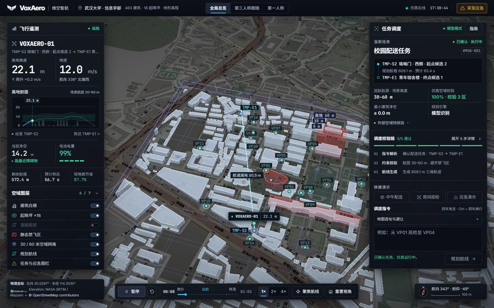
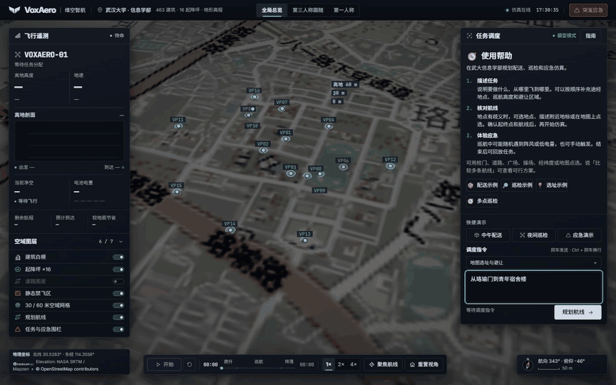

<p align="center">
  
</p>

<h1 align="center">VoxAero · 维空智航</h1>

<p align="center">武汉大学信息学部的低空三维调度与飞行仿真</p>

<p align="center">
  
  
  
  
  <a href="Test.md"></a>
</p>

<p align="center">
  <a href="#体验任务">🎮 体验任务</a> ·
  <a href="#快速开始">🚀 快速开始</a> ·
  <a href="#配置模型">🔧 配置模型</a> ·
  <a href="#测试与验收">🧪 测试与验收</a>
</p>

输入「从珞瑜门到青年宿舍楼」，调度台会先让你确认同名入口，再找出能起降、能接入航层的地面位置。选好候选后，可以跟随无人机起飞，切到第一人称查看航道引导，并在出现临时禁飞区时观察它从当前机位绕飞。



<details>
<summary>🎬 观看 8 秒仿真动图 · 从指令补答到第一人称飞行</summary>



</details>

## 体验任务

| 想验证什么 | 试着输入 |
| --- | --- |
| 同名地点消歧与动态选址 | **从珞瑜门到青年宿舍楼** |
| 多点巡检与高度限制 | **从星湖南路出发，依次途经星湖、星空广场，最后到信息学部操场巡检，巡航高度60到80米** |
| 空域核验 | **核验图书馆静谧区是否禁飞** |

1. 对话有歧义时，按提示选择入口或补充附近地标。地图会区分原地标和可行的实际落点。
2. 点击「采用候选」或「采用航线」，再点击「确认并开始仿真」。全局总览、第三人称跟随和第一人称视角均可切换。
3. 巡航中打开「突发应急」，试一次临时禁飞绕飞或低电量备降。停机后在「最近任务记录」打开回放。

每次规划按当前场景检查地形、建筑包络、静态禁飞区和任务避让条件。配送默认使用 **30–60 米**航层，巡检默认使用 **60–90 米**航层。绕飞保留未完成的途经点，低电量备降会估算航程、爬升与落地余量。结果适用于当前仿真场景。

## 快速开始

需要 Conda 和支持 WebGL 的浏览器。首次使用可克隆仓库，已有工作区可直接进入项目根目录。

```powershell
git clone https://github.com/Qua-Drant/VoxAero.git
cd VoxAero
```

```powershell
conda create -n VoxAero python=3.11 -y
conda run -n VoxAero pip install -r requirements.txt
conda run --no-capture-output -n VoxAero uvicorn backend.main:app --reload
```

打开 [本地调度台](http://127.0.0.1:8000/)。已有 `VoxAero` 环境时，可从安装依赖开始。也可以先运行 `conda activate VoxAero`，再执行 `uvicorn backend.main:app --reload`。若端口被占用，启动时加 `--port 8001` 后访问 [8001](http://127.0.0.1:8001/)。

FastAPI 同时提供页面和 API，前端无需构建。校园模型和地形由本机服务加载，CesiumJS 与地图瓦片由浏览器联网加载，无需 Cesium Ion Token。

## 配置模型

开箱即可使用本地规则完成调度。启用真实模型时，在项目根目录运行以下命令，再编辑本机的 `.env`。

```powershell
if (!(Test-Path -LiteralPath .env)) { Copy-Item -LiteralPath .env.example -Destination .env }
```

| 变量 | 填写内容 |
| --- | --- |
| `LLM_API_KEY` | 你的模型服务密钥，仅填入本机 `.env` |
| `LLM_BASE_URL` | 服务商的 OpenAI 兼容基础地址，例如 `https://api.openai.com/v1` |
| `LLM_MODEL` | 支持函数调用的模型标识，例如账户中可用的百炼 `qwen-flash` |

使用百炼时，从控制台复制基础地址，并选用同区域的密钥。`.env` 与环境文件变体由 Git 忽略，仓库提供 [.env.example](.env.example) 配置模板。系统环境变量优先于 `.env` 中的同名值。 [百炼 OpenAI 兼容接口](https://www.alibabacloud.com/help/en/model-studio/qwen-api-via-openai-chat-completions)

修改配置后重启。访问 [健康接口](http://127.0.0.1:8000/api/health) 查看运行模式。`live_llm` 表示已配置模型，单次调用的实际结果可在调度记录中查看。遇到模型超时或结果无法核对时，当次调度回到本地规则。`fallback_mock` 模式仍会根据当前场景计算三维航线。

## 测试与验收

[Test.md](Test.md) 记录每组测试的输入、预期结果、浏览器验收步骤和历次性能结果。自动化测试使用本地规则及模型接口替身，安装项目依赖即可运行。

```powershell
conda run --no-capture-output -n VoxAero pytest -q -s
```

按任务只运行相关用例。

| 想检查什么 | 命令 |
| --- | --- |
| 地名补答、动态选址、有序途经与应急预算 | `conda run -n VoxAero pytest -q tests/test_spatial_dispatch.py` |
| 三维规划、API 和静态资源 | `conda run -n VoxAero pytest -q tests/test_planner_and_api.py` |
| 实景 A* 性能 | `conda run --no-capture-output -n VoxAero pytest -q -s tests/test_real_scene.py -k real_scene_performance` |

在浏览器复跑时，可先关闭「随机应急演练」。从 [B03 用例](Test.md#浏览器验收) 验证两处校门起飞和抵达，再用 B07、B08 验证临时禁飞绕飞、低电量备降和重置。需要核对真实模型时，先完成上一节的配置，再查看调度结果中的运行模式。

## 场景与数据

默认读取 `data/`。自定义场景时，先复制整套数据到单独目录，再替换同名 GeoJSON 并用独立端口验收。

| 文件 | 数据契约 |
| --- | --- |
| `whu_buildings.geojson` | `Polygon`，`id`、`name`、`category`、`height`。地形启用时核对 `base_alt` 和 `collision_top_alt` |
| `vertiports.geojson` | `Point`，`id`、`name`、`type`、`altitude`。地面坪应贴地，屋顶坪应贴合对应屋面 |
| `nofly_zones.geojson` | `Polygon`，`id`、`name`、`min_alt`、`max_alt`、`reason` |

三个文件均为 WGS84 的 `FeatureCollection`，坐标按 `[经度, 纬度]` 排列。高度以米计，建筑、起降点、地形和围栏需使用同一场景高程基准。空间范围由 `backend/config.py` 的 `STUDY_BOUNDS` 定义。地标、路网和地形也应覆盖同一范围。

```powershell
$env:VOXAERO_SCENE_DIR = 'D:\scenes\whu-candidate'
conda run -n VoxAero uvicorn backend.main:app --port 8002
```

在 [候选场景](http://127.0.0.1:8002/) 核对白模、起降点、配送和巡检路线。停止对照服务后，可在同一终端运行 `Remove-Item Env:VOXAERO_SCENE_DIR` 恢复默认数据。修改数据后需重启服务。 [数据来源、许可与空域快照规范](data/README.md)

开发接口可通过 [FastAPI 文档](http://127.0.0.1:8000/docs) 查看。项目使用 OpenStreetMap 的建筑、道路和地标，以及 Mapzen 的 NASA SRTM 地形高程。
