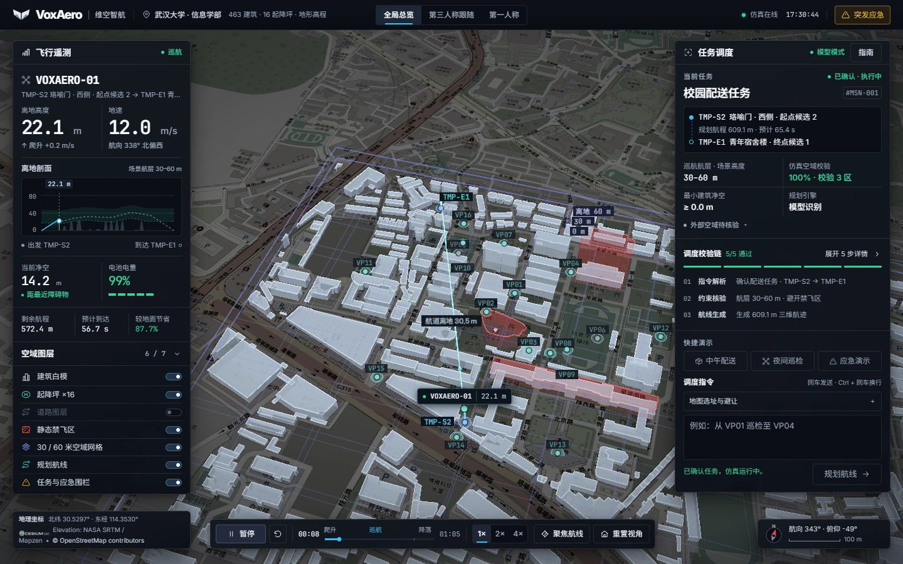
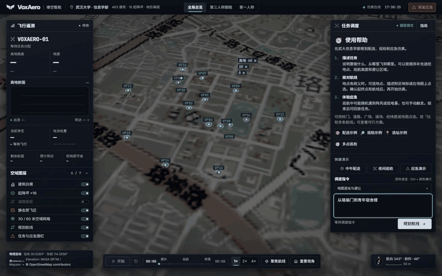
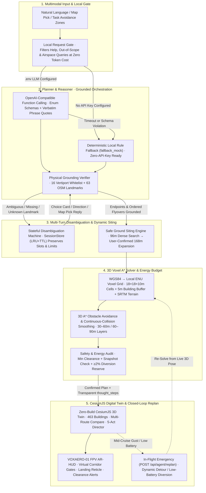

<p align="center">
  
</p>

<h1 align="center">VoxAero</h1>

<p align="center">Voxel-Based 3D Low-Altitude Navigation &amp; Spatial Agent Digital Twin Dispatch Platform<br>First Real-World Campus Scene: Wuhan University Information Sciences Campus (463 OSM Buildings + SRTM Terrain)</p>

<p align="center">
  <a href="README.md">中文</a> · <strong>English</strong>
</p>

<p align="center">
  
  
  
  <a href="docs/TEST_PLAN.md"></a>
  <a href="docs/TEST_PLAN.md#最近验证"></a>
  <a href="LICENSE"></a>
</p>

<p align="center">
  <a href="#system-architecture--anti-hallucination-design">🏗️ Architecture</a> ·
  <a href="#interactive-walkthrough">🎮 Walkthrough</a> ·
  <a href="#quick-start-zero-api-key-ready">🚀 Quick Start</a> ·
  <a href="#optional-llm-configuration">🔧 LLM Setup</a> ·
  <a href="#verified-benchmarks">📊 Benchmarks</a> ·
  <a href="#scene--data-contracts">🗺️ Data Contracts</a>
</p>

Type a natural-language mission such as *"From Luoyu Gate to Youth Dormitory"* (`从珞瑜门到青年宿舍楼`), and VoxAero detects the ambiguous twin campus gates, renders an interactive disambiguation card, dynamically discovers safe takeoff/landing ground sites within 96m/168m under real terrain and building clearance constraints, and computes collision-free 3D voxel trajectories. Launch with the **5-Act Auto-Director (`一键导播`)** or fly manually in **VOXAERO-01 First-Person AR-HUD** view, then inject **mid-flight temporary no-fly zones** or **low-battery alerts (≥2% landing reserve)** to watch real-time 3D rerouting and emergency diversion.



<details>
<summary>🎬 Watch 8-second Flight Demo · Multi-turn Disambiguation to FPV AR-HUD Cruise</summary>



</details>

---

## System Architecture & Anti-Hallucination Design

Low-altitude airspace has zero tolerance for spatial hallucinations: **LLMs excel at parsing ambiguous natural-language intent, but must never fabricate coordinates, altitudes, or safety guarantees.** VoxAero enforces strict **semantic-to-physical decoupling**—the LLM is restricted to schema-constrained parameter extraction, while every landmark lookup, ground siting check, 3D trajectory search, and energy reserve check is executed by deterministic geospatial engines.



### Four Guardrails Eliminating Spatial Hallucinations

1. **Enum-Locked Tool Schemas & Verbatim Quote Grounding**: `parse_dispatch_intent` constrains vertiport and no-fly zone IDs to live scene enums; `extract_spatial_task` requires verbatim substring quotes from the user prompt and rejects ungrounded or recycled slots, falling back deterministically on any violation.
2. **Stateful Multi-Turn Disambiguation (`SessionStore` LRU+TTL)**: Rather than guessing ambiguous entrances (e.g., East vs. West Luoyu Gate) or unknown sites, the backend issues a 10-minute `clarification_token` and preserves previously confirmed endpoints, flyovers, hard altitude bounds, and avoidance zones across turns.
3. **Deterministic 96m / 168m Siting & Local ENU 3D A***: Non-pad landmarks trigger ground candidate sampling within **96m**, rejecting roads, water bodies, steep terrain (>1.5m relief), obstacle clearances, no-fly zones, and unreachable vertical shafts; expanding to **168m** requires explicit user confirmation. All cruise legs are solved via 26-neighbor 3D A* on an **18×18×10m local ENU grid** (+5m building envelope) followed by continuous line-of-sight smoothing and corner chamfering.
4. **Closed-Loop Emergency Replanning & ≥2% Battery Reserve**: Mid-flight temporary no-fly zones trigger real-time 3D detours from the live airborne pose while preserving unvisited flyover waypoints. Low-battery diversions model flight duration plus cumulative climb energy and enforce a strict **≥2% landing battery reserve**, returning `HTTP 409` instead of issuing unsafe routes.

---

## Interactive Walkthrough

> **30-Second Showcase**: Launch the app and click **`一键导播` (Auto-Director)** in the right-hand console to watch a self-running **5-Act engineering demo** (Multi-route trade-off comparison → Vertical climb & chase camera → FPV AR-HUD cruise → Mid-flight wind-gust NFZ injection with live detour comparison → AR target landing & timeline replay). Manual controls take over smoothly at any moment.

You can also test these natural-language campus missions directly (currently tuned for Chinese campus landmarks & commands):

| Capability to Verify | Sample Command |
| --- | --- |
| Twin-gate disambiguation + 96m dynamic siting | `从珞瑜门到青年宿舍楼` |
| Ordered multi-flyover + multi-objective route comparison | `从星空广场起飞，依次途经星湖、星湖南路，最后到信息学部操场巡检，比较多条航线` |
| Hard altitude corridor bounds | `从星湖南路出发，依次途经星湖、星空广场，最后到信息学部操场巡检，巡航高度60到80米` |
| Airspace rule & source verification | `核验图书馆静谧区是否禁飞` |

---

## Quick Start (Zero-API-Key Ready)

VoxAero ships as a **zero-build frontend (native ES6 Modules + CesiumJS 1.119)** with **zero Cesium Ion Token requirement** and a **deterministic local rule engine (`fallback_mock`)**—clone and launch in three commands without configuring any API key.

Requires Conda and a WebGL-capable browser.

**Windows (PowerShell):**

```powershell
git clone https://github.com/Qua-Drant/VoxAero.git
cd VoxAero
conda create -n VoxAero python=3.11 -y
conda run -n VoxAero pip install -r requirements.txt
conda run --no-capture-output -n VoxAero uvicorn backend.main:app --reload
```

**macOS / Linux (bash / zsh):**

```bash
git clone https://github.com/Qua-Drant/VoxAero.git
cd VoxAero
conda create -n VoxAero python=3.11 -y
conda run -n VoxAero pip install -r requirements.txt
conda run --no-capture-output -n VoxAero uvicorn backend.main:app --reload
```

Open [http://127.0.0.1:8000/](http://127.0.0.1:8000/) (pass `--port 8001` if port 8000 is busy). The green **`本地规则` (Local Rules)** indicator confirms full zero-key readiness. Interactive OpenAPI docs are served at [http://127.0.0.1:8000/docs](http://127.0.0.1:8000/docs).

---

## Optional LLM Configuration

No `.env` is required to evaluate all workflows. To enable live OpenAI-compatible Function Calling (for colloquial phrasing generalization), copy `.env.example` to `.env`, populate your credentials, and restart:

```bash
[ -f .env ] || cp .env.example .env
```

| Variable | Description |
| --- | --- |
| `LLM_API_KEY` | Provider API key (stored locally in `.env`, git-ignored) |
| `LLM_BASE_URL` | OpenAI-compatible base URL (e.g., `https://api.openai.com/v1` or Alibaba Cloud Model Studio) |
| `LLM_MODEL` | Function-calling model ID (e.g., `qwen-flash`, `deepseek-chat`, `gpt-4o-mini`) |

Environment variables take precedence over `.env`. Check [http://127.0.0.1:8000/api/health](http://127.0.0.1:8000/api/health) to inspect `llm_mode` (`live_llm` vs `fallback_mock`). On network timeouts, malformed payloads, or ungrounded entities, VoxAero transparently falls back to deterministic local rules for that turn and logs the fallback inside `thought_steps`.

---

## Verified Benchmarks

Every test and benchmark runs locally without an API key. See [docs/TEST_PLAN.md](docs/TEST_PLAN.md) for the complete test matrix and historical baselines.

| Benchmark / Suite | Measured Result (Current `main`) | Notes / Historical Baseline |
| --- | --- | --- |
| **Pytest Regression Suite** | **68 / 68 passed** (`31.17s`) | Covers ENU geometry, 3D A*, multi-turn disambiguation, 96m/168m siting, ordered flyovers, emergency energy budget & LRU/TTL sessions (`f23fb45` baseline: 63 passed) |
| **WHU Real-Scene 3D A\* Benchmark** | **485 runs · 17.15 ms avg** (max `98.05 ms`) | All 16×15 ordered vertiport pairs × 2 corridors + 5 dynamic detours; well under the `500 ms` budget (`f23fb45` baseline: `22.09 ms`) |
| **Controlled Mock Scene Benchmark** | **65 runs · 14.26 ms avg** (max `65.65 ms`) | Exhaustive synthetic geometry & stacked restriction checks |
| **30-Case Dispatch Eval (`evaluate_dispatch.py`)** | Local **28/30** · `qwen-flash` **30/30** | 6 non-dispatch queries intercepted locally at zero token cost; 24 model calls with `0` fallbacks (`795.28 ms` avg) |

```bash
# Run full 68-test regression suite & 485-run real-scene benchmark
conda run --no-capture-output -n VoxAero pytest -q -s

# Run only the 485-run real-scene 3D A* latency benchmark
conda run --no-capture-output -n VoxAero pytest -q -s tests/test_real_scene.py -k real_scene_performance

# Run 30-case deterministic local dispatch evaluation without an API key
conda run --no-capture-output -n VoxAero python -m scripts.evaluate_dispatch --local-only
```

---

## Tech Stack & Core Modules

| Layer | Technologies & Responsibilities | Key Files |
| --- | --- | --- |
| **Backend API & Contracts** | Python 3.11, FastAPI, Uvicorn, Pydantic v2 — REST routes, OpenAPI schema, `scene_version` optimistic concurrency (`HTTP 409` on mismatch), static serving | [backend/main.py](backend/main.py) · [backend/schemas.py](backend/schemas.py) · [backend/config.py](backend/config.py) |
| **Agent & State Machine** | OpenAI Python SDK Function Calling, local gate classifier, hard/soft altitude parser, thread-safe LRU+TTL `SessionStore` (`10 min` clarification/candidate, `4 h` mission) | [backend/core/agent.py](backend/core/agent.py) · [backend/core/spatial_dispatch.py](backend/core/spatial_dispatch.py) · [backend/core/intent.py](backend/core/intent.py) · [backend/core/session.py](backend/core/session.py) |
| **3D Geospatial & Planning** | NumPy, Shapely 2.x, `STRtree` — WGS84→ECEF→ENU frame, 18×18×10m voxel grid, bilinear SRTM terrain clearance, 26-neighbor 3D A*, continuous-collision smoothing & corner beveling, external airspace snapshot datum conversion | [backend/core/airspace.py](backend/core/airspace.py) · [backend/core/planner.py](backend/core/planner.py) · [backend/core/terrain.py](backend/core/terrain.py) · [backend/core/rules.py](backend/core/rules.py) |
| **Zero-Build 3D Frontend** | Vanilla HTML5, ES6 Modules, CSS Design Tokens, CesiumJS 1.119 (dark OSM tiles, no Ion token) — custom `VOXAERO-01` GLB quadrotor, FPV Canvas AR-HUD, AGL vertical profile SVG, flight replay timeline & 5-Act Director | [frontend/index.html](frontend/index.html) · [frontend/js/map3d.js](frontend/js/map3d.js) · [frontend/js/drone_sim.js](frontend/js/drone_sim.js) · [frontend/js/ar_hud.js](frontend/js/ar_hud.js) · [frontend/js/demo_director.js](frontend/js/demo_director.js) |

### REST API Summary

| Endpoint | Purpose |
| --- | --- |
| `GET /api/health` | Service metadata (`service: "VoxAero"`) and active engine mode (`live_llm` / `fallback_mock`) |
| `GET /api/layers/all` | Buildings, vertiports, no-fly zones, roads, landmarks, SRTM terrain, corridor specs & `scene_version` |
| `POST /api/agent/dispatch` | Natural-language mission dispatch, multi-turn disambiguation replies, candidate routes & airspace checks |
| `POST /api/agent/confirm-candidate` | Deterministically re-verifies selected candidate by `candidate_token` and issues `mission_token` |
| `POST /api/agent/replan` | Mid-flight temporary NFZ detour or low-battery diversion (enforcing ≥2% arrival reserve) |
| `POST /api/agent/restart-mission` | Resets dynamic hazards and issues a fresh mission session token for replay/restart |

---

## Scene & Data Contracts

The default Wuhan University scene is loaded from `data/`. Any compatible WGS84 (`EPSG:4326`) scene directory can be mounted via `VOXAERO_SCENE_DIR`:

| File | Contract (WGS84, altitudes in meters) |
| --- | --- |
| `whu_buildings.geojson` | `Polygon` features with `id`, `name`, `category`, `height` (plus `base_alt` & `collision_top_alt` when terrain is enabled) |
| `vertiports.geojson` | `Point` features with `id`, `name`, `type` (`logistics` / `inspection` / `emergency`), `altitude` |
| `nofly_zones.geojson` | `Polygon` features with `id`, `name`, `min_alt`, `max_alt`, `reason` |

See [data/README.md](data/README.md) for vertical datum details, external airspace snapshot (`airspace_rules.geojson`) schema, and offline scene reconstruction scripts.

---

## License & Attribution

- Source code is licensed under the **[MIT License](LICENSE)** (`Copyright (c) 2026 Qua-Drant`).
- Campus building footprints, roads, and landmarks are derived from OpenStreetMap (`© OpenStreetMap contributors`, **ODbL 1.0**); elevation tiles originate from NASA SRTM via Mapzen / AWS Open Data; bundled web fonts retain their **SIL OFL 1.1** licenses (see [frontend/assets/fonts/README.md](frontend/assets/fonts/README.md)).
